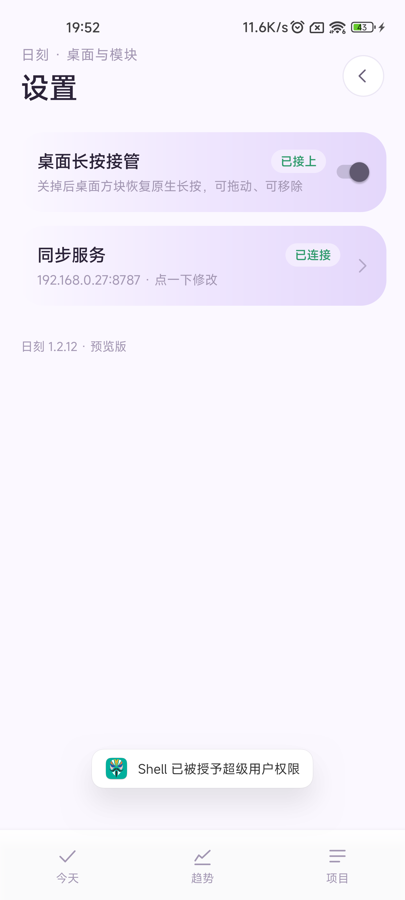
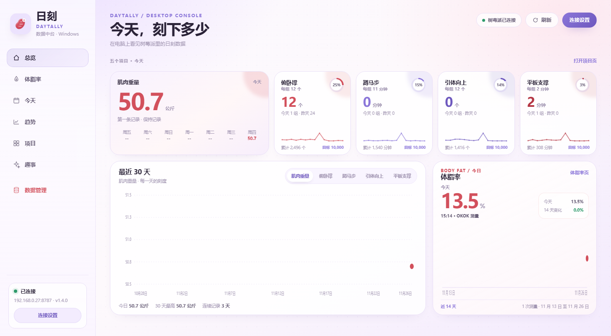
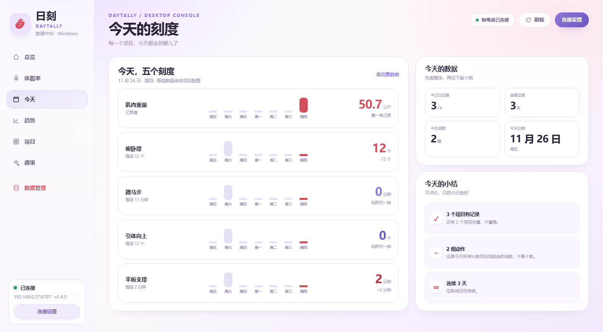
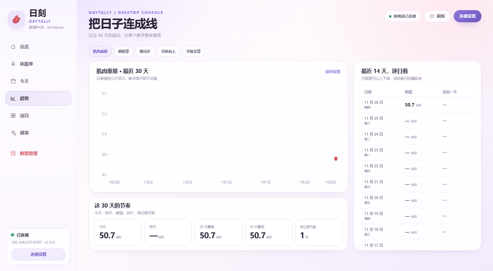

# 日刻 · daytally

**桌面点一下，数字就刻上去；两台手机不打开 App，也能看到同一个数。**

一个极简的每日自我量化工具。把「今天做了多少」放在桌面：点一下方块加一组，抬眼就能看见这一周攒到哪了。


## 一眼看懂

| 今天 | 趋势 | 项目 | 设置（隐藏页） |
| --- | --- | --- | --- |
|  |  |  |  |

| 电脑 · 总览 | 电脑 · 今天 | 电脑 · 趋势 |
| --- | --- | --- |
|  |  |  |

当前开发版本 **1.4.1**（2026-11-26）。安装包在本仓库 `DailyScale/dist/日刻-1.4.1.apk`，电脑端在 `PC/日刻数据中台-1.4.1.exe`；发布页见 [Releases · v1.4.1](https://github.com/seashell666/daytally/releases/tag/v1.4.1)。

## 它为什么存在

想记录每天做了多少，但不想要一个塞满课程、社区、勋章、打卡地图的健身 App。

日刻只做三件事：

1. **今天做了多少**——点一下加一组，直接累加
2. **这周是什么走势**——7 天 / 30 天折线，一眼看趋势
3. **离目标还有多远**——累计对比目标，环和颜色一起走

其余的都交给桌面：不用打开 App，点一下桌面那块小方格就加了一组。

## 细分价值

### 桌面就是主界面

- 4 个 1×1 方块：俯卧撑 / 蹲马步 / 引体向上 / 自定义
- 3 张 4×2 大卡：肌肉重量卡、体脂率卡、计数卡（7 天矩阵 + 项目切换）
- 方块点一下加一组，环朝总目标走；大卡固定 **周二 → 周一**，不用记今天排在哪
- 单击有 36ms 最大振幅的触感，户外/口袋里也能感觉到；不会像长震动那样拖沓

### 记录成本几乎为零

- 不打开 App、不点进项目、不填表：桌面一次点击就是一条记录
- 加组/减组有 `+12` / `−12` 飘字和缩放反馈，点完就知道记上了
- 肌肉重量和体脂率各有一张渐变卡；点「去记录」打开 OKOK 官方称重，测完自动取回，不污染计数流程

### 两台手机实时同数（1.2.12）

- 一台手机在桌面点一下，另一台手机的桌面组件在 **约 1 秒内**跟着变
- 不需要两台都打开 App；另一台只要组件在桌面、Wi‑Fi 连着即可
- 首次连接时服务端空库才用第一台手机的快照做基线；第二台不会把旧历史重复加一遍

### 数据是自己的

- 默认只存手机本地；不登录、不上传公网
- 配了自家后端才同步，数据只走局域网
- 加/减按**事件**合并，不是拿总数覆盖；A 加 3 组、B 加 1 组，最后是 4 组

## 怎么用

### 第一次用

1. 安装 APK，打开一次 App
2. 在桌面添加「日刻」的方块和大卡（长按桌面空白 → 添加小部件）
3. 要两台手机同步：进隐藏设置页，点「同步服务」卡，填自家后端的 IP、端口和访问令牌

> 覆盖安装或系统升级后，建议打开一次 App，让实时同步服务拿到通知权限并启动。之后重启手机，开机广播会自己把它拉起来；1.2.12 已在两台小米 11 / MIUI 14 上验证。

### App 三页

- **今天**：按项目列出今天累计值，右侧大按钮加一组；顶部是本周 7 天条带（红涨绿落）
- **趋势**：项目切换 + 三栏统计（最高 / 变化 / 最低）+ 折线图（面积渐变、末点高亮）+ 逐日明细
- **项目**：每个项目的每组数量、累计、目标、纵轴范围，点卡片改设置

### 隐藏交互（很多人第一次找不到）

| 想做什么 | 怎么做 |
|---|---|
| 进隐藏设置页 | 项目页长按「项目」二字 **0.7 秒**；底栏「项目」Tab 长按 **0.7 秒**；今天页按住左上角日期也行 |
| 桌面方块加一组 | 点方块本体（数字/文字/圆环都行），不用打开 App |
| 桌面方块减一组 | 长按方块 **0.15 秒**（需要桌面钩子已接上，见下文） |
| 记录肌肉重量 / 体脂率 | 点对应大卡的「去记录」，打开 OKOK 官方称重；测完自动回传。只有没收到 OKOK 结果时才出现手动兜底 |
| 切换大卡显示的项目 | 点计数大卡上的「俯卧撑 / 蹲马步 / 引体向上 / 自定义」胶囊 |
| 清空某个项目 | 项目页点进对应卡片 → 清空；会记一个截止时间，不会把历史误删成“从没发生过” |
| 关掉桌面长按接管 | 隐藏设置页第一张卡的开关；关掉立刻恢复 MIUI 原生长按，可拖动、可移除 |

## 两台手机实时同步（1.2.12）

### 你看到的现象，和之前为什么不一样

1.2.11 及以前，另一台手机只有在 **打开 App**、或 **Wi‑Fi 从断到连** 时才会去拉最新快照。服务端即使已经有 34 组，另一台手机桌面上的组件仍可能停在 33——因为它根本没有收到“数据变了”的通知，也没有一个常驻的接收通道。

这不是你少提了一个需求，而是旧链路只做了“打开 App 才拉取”。1.2.12 补上了两件事：

1. **桌面点击会立刻上传**：`WidgetProvider` 处理加/减时用 `goAsync()` 把广播生命周期挂到网络回包之后；即使 App 主界面没打开、进程之前没在后台，点击也会把这次变化发到服务端。
2. **另一台手机会收到推送**：App 里跑一个 `dataSync` 前台服务，保持一条 SSE 长连接。服务端写入成功后广播 `change`，另一台手机收到就拉一次快照，并刷新桌面组件。即使它没打开 App，组件也会变。

### 低延迟、低能耗是怎么做的

- **不轮询**：空闲时没有每秒请求；SSE 连接上只有服务端每 **25 秒**一次心跳（`: ping`），用来保活和发现断线
- **点击即时**：桌面组件点击走 `urgent` 同步，不受平时 1.8 秒合并窗口的拖累；网络回包前广播进程不会被系统提前回收
- **收到推送只拉一次**：不是每次心跳都拉数据；只有服务端真的写入后才发 `change`
- **刷新范围小**：只重绘 4 个方块、2 张大卡，不启动 App 主界面
- **代价**：同步配置后，会有一条低重要性常驻通知「日刻 · 实时同步」。这是前台服务的系统要求，不是广告；它不是零耗电，但空闲时几乎不跑 CPU、不产生流量

### 实测

两台小米 11、同一 Wi‑Fi、服务端在树莓派 `192.168.1.50:8787`（示意地址）：

- 旧手机在桌面点「自定义」：34 → 35，服务端 `revision` 立刻变化
- 新手机没打开 App，桌面组件在 **1.2 秒内**从 34 变 35
- 再把新手机重启，不打开 App：开机广播拉起同步服务，旧手机点一下，新手机组件仍然跟着变
- App 主界面被系统回收后，旧手机在桌面点方块仍能把变化发出去（`goAsync` 保活到 HTTP 回包）

### 设置同步服务

公开包**不含任何服务器地址或 Token**，装好后自己填：

1. 进隐藏设置页（项目页长按「项目」0.7 秒）
2. 点「同步服务」卡
3. 填树莓派的局域网 IP、`8787` 端口、`.env` 里的同一个 Token
4. 点「保存并连接」

保存后卡片显示 `IP:端口 · 点一下修改`，状态分「未设置 / 待连接 / 已连接 / 连不上」。换 IP、换 Token 都在这张卡里改，不用重新打包；换服务器会清掉旧的同步游标，避免拿旧服务器的响应当成新数据。


### 机型限制（必须知道）

这是**低功耗长连接**，不是系统级推送，所以仍然受手机厂商的后台策略影响：

- 小米 / MIUI：建议在手机管家里给「日刻」允许**自启动**，省电策略设为**无限制**；否则系统可能在长时间待机后杀掉服务
- 如果服务被杀了：桌面组件还在，但不会实时变；打开一次 App、重启手机、或 Wi‑Fi 重新连上后会恢复
- 第一次装好/覆盖安装后，系统可能不允许后台直接拉起前台服务；打开一次 App 就能把服务启动起来
- 锁屏后如果系统进入深度休眠，长连接可能被断开；解锁/亮屏后会自动重连

> 一句话：能做的部分是“常驻长连接 + 事件推送”；做不到的是“绕过厂商后台限制”。README 不宣称零耗电，也不宣称任何机型都绝对不被杀。

## 同步是怎么合并的

同步不是“拿整份数据覆盖”，而是记“事件”：

- 每次加一组 / 减一组，客户端记一条 `add` / `remove` 事件，带唯一 id、项目、日期、发生时间；服务端按事件 id 去重后**求和**
- A 手机加 3 组、B 手机加 1 组，最终就是 4 组。谁先同步、谁后同步都不会把对方的增量覆盖掉
- 肌肉重量、项目配置按发生时间取最新；清空记一个截止时间，早于它的旧事件不再计入
- 第一次连接时客户端会带整库快照。服务端**只有空库**才拿它当基线；已有数据只拉取，不重复播种
- 两台手机同时改、时间戳撞车也没关系：服务端按事件 id 去重、按发生时间合并，最后把权威快照回写给两台手机

服务端对外只有四个接口：

- `GET /health`：健康检查，不需要 Token
- `GET /api/v1/snapshot`：读取权威快照，需要 Bearer Token
- `POST /api/v1/sync`：推事件 + 拉快照，需要 Bearer Token
- `GET /api/v1/stream`：SSE 长连接，服务端写入后推 `event: change`，需要 Bearer Token

## 进阶：桌面长按接管与 Vector 模块

App 自己就是 Xposed 模块，**长按减组靠它**——不需要再装第二个 APK。

从 1.2.9 起，设置页不再单独放“桌面长按体检”卡片：状态直接跟在「桌面长按接管」标题后面，绿色「已接上」表示钩子已经在当前桌面进程里干活，黄色「该复测了」表示桌面重启过、还没收到新心跳，红色「未接上」表示作用域或模块没生效。下面仍保留一个总开关，关掉就能拿回 MIUI 原生长按。

### 启用

1. Vector（或 LSPosed）→ 打开「日刻」总开关
2. 点进「日刻」→ 作用域勾选两个：
   - `com.beike.daytally`
   - **`com.miui.home`（系统桌面，不是米家）**
3. 重启桌面生效：`adb shell am force-stop com.miui.home`，再按一下 Home

### 为什么长按必须靠模块

MIUI 桌面的触摸**根本不进组件自己的 View**，全被 `com.miui.home.launcher.widget.DragContainerLayout` 这一层收走，长按菜单也是它弹的。所以只有在桌面进程里挂钩子，才能做出「长按方块 = 减一组」，并把震动、缩放入场、浮动数字一起画在桌面层。

没有模块时：方块单击加组照常（走原生 PendingIntent），但**长按不能减组**，也没有 0.93 缩放和 `+12` 飘字。

### 关掉模块后长按怎么恢复

**这是 LSPosed 的机制限制，不是 bug**：关模块只是让下次启动不再注入，**已经注入进桌面进程的钩子还活着**，所以长按依旧被接管。

三种恢复方式，按推荐顺序：

| 方式 | 操作 | 生效 |
|---|---|---|
| **App 内开关（推荐）** | 日刻 → 项目页长按「项目」二字 0.7 秒（底栏「项目」Tab 长按 0.7 秒也行）→ 进隐藏设置页 → 关掉「桌面长按接管」 | **立刻**，不用重启任何东西 |
| 重启桌面 | `adb shell am force-stop com.miui.home` 后按 Home | 立刻 |
| 关模块 + 重启桌面 | 两件都要做 | 立刻 |

App 里那个开关是往桌面进程发一条广播，钩子收到就自动置为「不接管」，所以是拿回原生长按最快的方式。

> Vector 本身没有软重启命令。查过 `/data/adb/lspd/cli` 的全部子命令（`status` / `modules` / `scope` / `config` / `db` / `log`），也 grep 过 `/data/adb/lspd` 与 `/data/adb/modules/zygisk_vector`，都没有 soft-reboot 相关入口。所以「关模块后立刻恢复」只能靠 App 内这个开关，不需要重启手机。

> 模块开启期间，桌面上长按方块会**被钩子整条吃掉**，MIUI 原生的「移除 / 编辑」菜单不会弹。要整理桌面，先关上面那个开关。

### 误触修复：怎么区分「点方块」和「点方块上面的东西」

旧版钩子挂在全局 `View.dispatchTouchEvent`，**只要坐标落在方块附近就吃掉事件**。结果很糟：文件夹展开后点里面的图标、从多任务切到别的 App，都会被当成点了方块，组数白涨。

现在改成“真实矩形 + 首点兜底”三层判定，**只有真的点在方块上才接管**：

1. **遮挡判定**——从 `DecorView` 往下找 `Folder`、或类名含 `Recents`/`MultiTask`/`TaskView` 的可见全屏 View，命中就直接放行；再用反射 `WindowManagerGlobal.mViews` 兜住所有窗口根视图。
2. **真实矩形判定**——四个 1×1 方块的 `LauncherAppWidgetHostView` 不一定在 `DecorView` 子树里（MIUI 把它们挂在 `DragContainerLayout` 的登记表上），所以从 `hostViews` 登记表取每个 key 的宿主，用 `getLocationOnScreen` 得到真实左上角和宽高，手指必须落在这个矩形里（边缘放宽 4px）。不再用“最近邻 + 210px”的圆形兜底，避免伸到隔壁方块。
3. **首点兜底**——桌面刚重启/组件刚刷新时 `hostViews` 登记表可能还没建好。这时沿当前 View 的父链最多 10 层找真正的 `AppWidgetHostView`，再用当前叶子/宿主矩形判断；同时直接给 `AppWidgetHostView.dispatchTouchEvent` 挂钩子，覆盖“第一下没人接”的窗口期。
4. **抬手兜底**——同一个手势只认 `downTime`，不再要求“按下层 === 抬层层”。这样按下被某一层吃掉、抬手被另一层接走时，仍然会正常结算，不会出现“点了但没加组”。

真机双向验证：重启桌面后第一次点俯卧撑文字上半部 → 组数 +1；四个方块分别点文字/数字/圆环 → 各自只加自己的组；点卡片边缘留白 → 进 App 而不是加组；点文件夹里的图标 → 不误触。

### 已知限制：多任务界面里点方块会误加组

MIUI 13 的最近任务是 `RecentsAnimation`，**不产生新的 Activity**，桌面一直停在 `Launcher`，窗口焦点也还在。所以钩子没法分辨「用户是在桌面上点方块」还是「在多任务缩略图里点了同一块区域」——在任务切换界面按到方块的位置，仍会加一组。

试过四种判断都不成立（扫 Recents 类名、扫 `RecentsActivity` 可见性、反射 `ActivityThread` 的活动栈、判 `hasWindowFocus`），最激进的那版会让桌面正常状态下的所有点击被吃掉（长按直接弹 MIUI「移除」菜单），比误触更糟，已回退。**这条按取舍保留，不算 bug**：宁可多任务里偶尔误加，也不牺牲桌面上正常的点按与长按。

## 技术栈

- Kotlin，原生 Android View + Canvas，**没有引入任何第三方 UI 框架**
- 依赖只有 androidx 基础库（core-ktx / appcompat / material / constraintlayout / recyclerview）
- 数据默认落本地 JSON（应用私有目录）；在设置页「同步服务」里填自家后端地址和 Token 后，按事件增量同步到树莓派，不经过公网；地址和 Token 存在本机 `SharedPreferences`，不进 APK、不进仓库
- 实时同步：`SyncPushService` 前台服务 + SSE；桌面点击用 `goAsync()` 保活；`BootReceiver` 监听开机和覆盖安装
- 同步后端：Python 标准库 + SQLite，单文件 `server/app.py`，Docker 镜像 `python:3.12-slim`
- minSdk 26 / targetSdk 34

UI 是按一份 HTML 原型 1:1 复刻的。原型屏幕逻辑宽 350px，真机逻辑宽 411dp，所以全局用 `Ui.S = 1.175` 做等比换算——尺寸、字号、间距一起放大，比例才不走样。这段逻辑在 `DailyScale/app/src/main/java/com/beike/daytally/util/Ui.kt`。

## 构建与签名

需要 JDK 17 与 Android SDK 34。

```bash
cd DailyScale
./gradlew assembleRelease
```

产物在 `app/build/outputs/apk/release/app-release.apk`。公开包就是唯一构建产物，不读取任何本地服务器地址或 Token；同步信息全部由用户在设置页里运行时填写。

**这个仓库不含任何签名私钥。** 想在本地打 release 包，在 `DailyScale/` 下自建 `keystore.properties`（已列入 .gitignore）：

```properties
storeFile=app/keystore/your.jks
storePassword=...
keyAlias=...
keyPassword=...
```

没有这个文件时，`release` 会自动退回 debug 签名，所以 clone 下来照样能构建、能装。

## 后端部署（树莓派 / Docker）

> 这一段是给“想把数据放在自己家里”的人看的。不配也能用，App 仍然只存本地；配了之后，手机只在 Wi‑Fi 下和自家树莓派同步，数据不出局域网。

### 树莓派准备

- Ubuntu / Raspberry Pi OS 均可，装好 Docker 与 Compose 插件
- 给树莓派在路由器里固定一个局域网 IP（例如 `192.168.1.50`），别让它每次重启换地址
- 确认 `8787` 端口没被占用

```bash
docker --version
docker compose version
ss -lntp | grep 8787
```

### 部署

在仓库根目录执行（把 `你的用户名` 和 `树莓派IP` 换成实际值）：

```bash
# 1. 树莓派上建目录
ssh 你的用户名@树莓派IP
sudo mkdir -p /opt/daytally-sync/data
sudo chown -R $USER:$USER /opt/daytally-sync
exit

# 2. 从电脑上传后端源码
scp -r server/* 你的用户名@树莓派IP:/opt/daytally-sync/

# 3. 登录树莓派，生成 Token
ssh 你的用户名@树莓派IP
cd /opt/daytally-sync
cp .env.example .env
openssl rand -hex 16
nano .env
```

`.env` 只需要两行（Token 填上一步生成的那串）：

```properties
DAYTALLY_TOKEN=粘贴32位十六进制Token
TZ=Asia/Shanghai
```

然后启动：

```bash
docker compose up -d --build
docker compose ps
curl http://127.0.0.1:8787/health
```

健康接口正常时返回：

```json
{"ok":true,"service":"daytally-sync","version":"1.4.0","seeded":true,"bodyFatSupported":true,"muscleSupported":true}
```

`docker compose ps` 里 `daytally-sync` 应该是 `running (healthy)`。`docker-compose.yml` 已经写了 `restart: unless-stopped`，Docker 服务也 `systemctl enable docker` 后，树莓派断电重启会自动把后端拉起来；数据落在宿主机的 `./data/daytally.db`，重建容器不会丢。

### 维护

```bash
cd /opt/daytally-sync

# 看日志（Ctrl+C 退出）
docker compose logs -f --tail=100

# 重启
docker compose restart

# 改了 app.py / compose 后重建
docker compose up -d --build

# 停止 / 启动
docker compose stop
docker compose start
```

备份 SQLite（先停再复制，最稳）：

```bash
cd /opt/daytally-sync
docker compose stop
cp data/daytally.db data/daytally.db.$(date +%F).bak
docker compose start
```

恢复：

```bash
cd /opt/daytally-sync
docker compose stop
cp data/daytally.db.2026-11-21.bak data/daytally.db
docker compose start
```

### 常见问题

| 现象 | 先查什么 |
|---|---|
| 手机同步没反应 | 手机和树莓派是否同一个 Wi‑Fi；App 是否只在 Wi‑Fi 下同步；设置页「同步服务」卡里的 IP / 端口有没有填对，状态是不是「连不上」 |
| 另一台手机组件不跟着变 | 服务端 `version` 是否 1.2.12 以上（1.2.9 没有 `/api/v1/stream`）；另一台是否允许自启动/省电无限制；打开一次 App 看服务是否在跑 |
| `curl` 连不上 | `docker compose ps` 是否 healthy；`ss -lntp \| grep 8787` 是否有进程；树莓派防火墙是否放行 8787 |
| 返回 401 | App 的 `token` 和 `server/.env` 的 `DAYTALLY_TOKEN` 不一致 |
| 端口被占用 | 改 `docker-compose.yml` 的 `8787:8787` 左侧端口，同时改 App 的 `baseUrl` |
| 数据想重来 | 停容器，把 `data/daytally.db` 改名留档，再启动；不要直接删正在用的库 |

> 这是**局域网服务**，不要把 8787 映射到公网，也不要把 `.env` 发出去。Token 是唯一门槛，泄露了就在树莓派上换一串，手机端在「同步服务」卡里重新填一次即可，不用重打包。

## 电脑端（Windows 数据中台）

手机只负责记，电脑负责看全。`PC/日刻数据中台-1.4.1.exe` 是一个双击就能跑的绿色程序，不装任何运行库，数据全部从你自己的树莓派上取，不经过任何外部服务器。

### 第一次用

1. 双击 `日刻数据中台-1.4.1.exe`，窗口标题是「日刻 · 数据中台」，默认最大化打开。
2. 右上角点「连接设置」，填树莓派 IP、端口 `8787`、访问令牌（就是 `server/.env` 里的 `DAYTALLY_TOKEN`），点「测试连接」再「保存并连接」。
3. 左下角状态变成绿点「已连接 192.168.x.x:8787 · v1.4.0」就通了。地址会记住，下次打开自动连。

也可以带参数启动（适合固定在一台机器上）：

```powershell
.\日刻数据中台-1.4.1.exe --serve-only --port 8767          # 只起本地服务，不弹窗口（调试/截图用）
.\日刻数据中台-1.4.1.exe --base-url http://192.168.1.50:8787 --token <Token>
```

> 带 `--base-url` / `--token` 启动会把它们写进 `%APPDATA%\DayTallyDesktop\config.json`，覆盖掉界面上手工填的值。只想临时看一眼就别带这两个参数。

### 七个页面

| 页面 | 看什么 |
| --- | --- |
| 总览 | 5 张指标卡（肌肉重量 + 4 个计数项目），每张卡右上角是完成度环形，下面一行是近 14 天迷你折线；右边是今天体脂 + 近 14 天体脂小图 || 体脂率 | 5 张渐变统计卡 + 左边 30 天折线 + 右边历史明细 |
| 今天 | 左边五个刻度铺满，右边今天的数据四格 + 今天的小结三条 |
| 趋势 | 上方 30 天折线，右侧「最近 14 天，逐日看」方框（框内可滚、滚动条隐藏），下方「这 30 天的节奏」 |
| 项目 | 5 张项目卡，单击看详情、双击改目标 |
| 趣事 | 每天的小结与记录 |
| 数据管理 | 连接、备份、清缓存这些运维操作 |

交互上有三条约定：

- **整页不滚动**：所有页面都按窗口高度排好，一屏装下，右侧没有滚动条；只有趋势页右侧那个 14 天方框内部可以滚。
- **切指标只换图**：点「肌肉重量 / 俯卧撑 / 蹲马步 / 引体向上 / 平板支撑」页签，只重画图表区，页面不闪、滚动位置不动。
- **弹窗点外面就关**：任何弹窗（连接设置、项目详情、项目编辑……）在卡片外的灰色遮罩上单击都能关，`Esc` 也可以。

### 从源码打包

仓库里的源码在 `PC/source/`（`app.py` + `web/` + `build.ps1`）。这台机器上的工作目录是 `C:\windows软件编译\daytally-dashboard`，构建用的 Python 固定放在 `C:\windows软件编译\venv`：

```powershell
cd C:\windows软件编译\daytally-dashboard
& .\build.ps1     # 输出 dist\日刻数据中台.exe
```

界面是 `web\` 下的纯 HTML/CSS/JS，Python 侧只做三件事：起本地 HTTP 服务、代理树莓派接口、用 WebView2 套一个原生窗口。EXE 用 PyInstaller 打成单文件，目标机器不用装 Python。

## 项目结构

```
身高计数组件App/
├── DailyScale/                        Android 工程（Gradle）
│   ├── app/src/main/java/com/beike/daytally/
│   │   ├── MainActivity.kt            三页容器 + 底栏
│   │   ├── Repo.kt                    本地 JSON 读写 + 种子数据
│   │   ├── model/Metric.kt            项目数据模型
│   │   ├── sync/                      事件队列 / HTTP 同步 / SSE 前台服务 / 开机广播
│   │   ├── ui/HomeView.kt             今天页
│   │   ├── ui/TrendView.kt            趋势页
│   │   ├── ui/ChartView.kt            折线图（Canvas，按 320×200 viewBox 等比）
│   │   ├── ui/ProjectsView.kt         项目页
│   │   ├── ui/SettingsView.kt         隐藏设置页
│   │   ├── util/Ui.kt                 等比换算 dp / sp / wdp
│   │   └── widget/                    5 个桌面组件
│   └── app/src/main/res/              布局、drawable、主题
├── server/                            树莓派同步后端（Docker + SQLite）
│   ├── app.py                         HTTP API + 事件合并 + SSE + SQLite
│   ├── Dockerfile                      python:3.12-slim + HEALTHCHECK
│   ├── docker-compose.yml             8787 端口、./data 持久化、自动重启
│   └── README.md                      后端接口与部署细节
├── PC/                                Windows 数据中台（源码在 C:\windows软件编译\daytally-dashboard）
│   ├── 日刻数据中台-1.4.1.exe          双击即用，WebView2 套壳
│   └── 日刻数据中台-1.4.0.exe          上一版，留作回退
├── docs/                              交付与验收报告、真机测试步骤、各阶段变更清单
├── 每日刻度APP原型版本1.html           设计基准（当前 v12，与 1.2.12 真机对齐）
├── 每日刻度APP原型版本1修改备份/       v1～v12 迭代留档
├── 每日刻度APP原型版本2修改备份/       下一轮改版用
├── 宣发/                              给 Claude / ChatGPT / Seedance 的宣发素材包（含 manifest.json）
├── docs/screenshots/
└── 小刻度-App落地方案与提示词.md        早期落地方案
```

> `DailyScale` 是工程的早期目录名，一直没改；实际包名与项目名是 `com.beike.daytally` / daytally。

## 原型与版本

`每日刻度APP原型版本1.html` 是这套 UI 的唯一设计基准，直接浏览器打开就能看，所有尺寸、配色、文案以它为准。备份目录里共 12 份留档（v1～v12），统一命名 `小刻度-App原型-vN备份YYYYMMDD.html`（第一份没有版本号，叫 `小刻度-App原型-备份20261116.html`），当前定稿是 **v12**：在 v11 的隐藏设置页基础上，补了 1.2.12 的「同步服务」卡与同步弹窗，并把演示数据、趋势默认俯卧撑、桌面大卡默认蹲马步全部对齐真机。

> 备份只在备份目录留一份，工作目录根下不放同名副本；命名按版本号连续，别用「第 N 版」这种会跟「原型一 / 原型二」混淆的叫法。

下一轮大改会另起 `每日刻度APP原型版本2.html`，备份进 `每日刻度APP原型版本2修改备份/`。

## 宣发素材包

`宣发/` 是给 Claude / ChatGPT / Seedance 2.5 的“产品说明书 + 素材库”：产品一页纸、功能清单、页面交互、视觉规范、导演手册、AI 使用说明、版本信息，加上真机截图、v12 原型、卡片切图、品牌图标、主视觉、六帧故事板、两机同步示意和 Kotlin 源码快照。

- 入口：`宣发/README.md`、`宣发/00-START-HERE.md`
- 机器可读索引：`宣发/manifest.json`
- 屏幕结构：`宣发/code/screen-map.json`
- 设计变量：`宣发/code/design-tokens.json`
- 打包：项目根目录的 `日刻1.2.12-宣发素材包-20261122.zip`

## 更新日志

见 [CHANGELOG.md](CHANGELOG.md)。

## License

MIT
