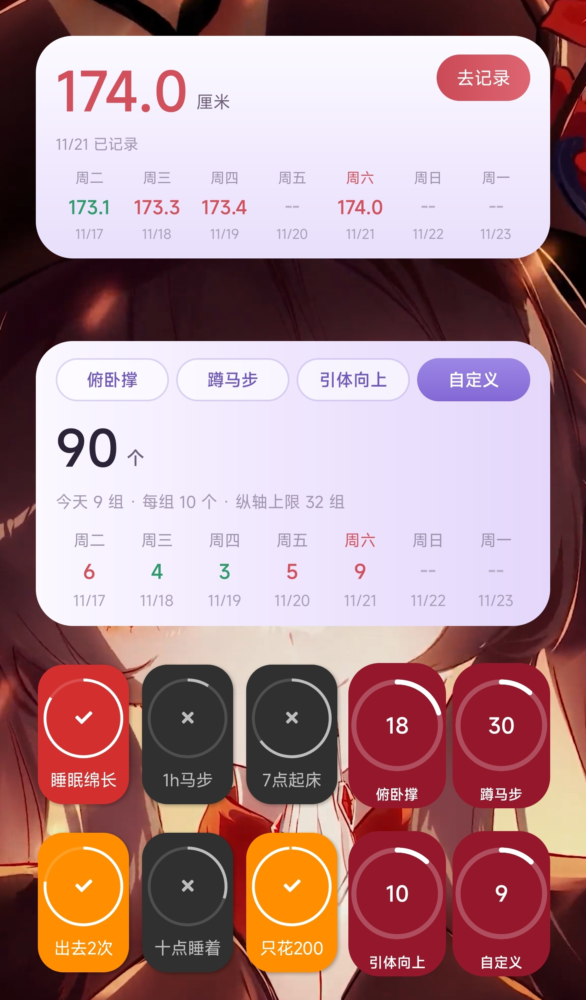
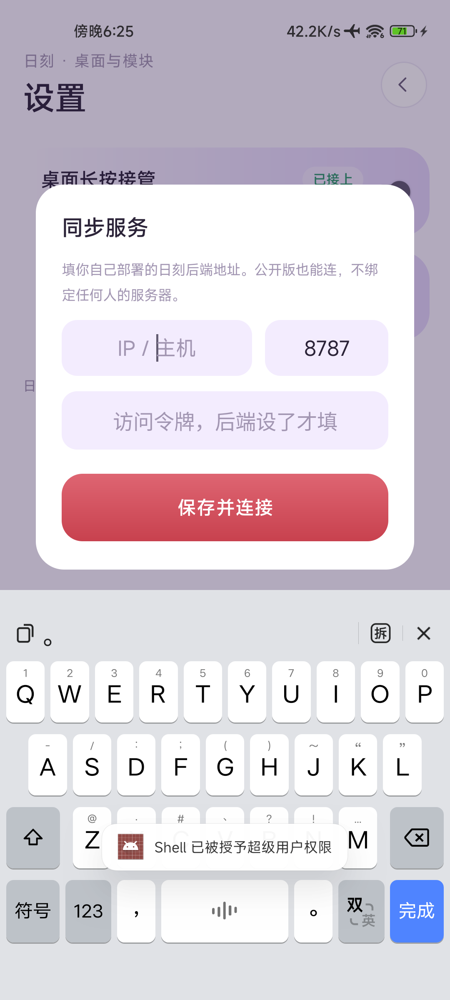

# 日刻 · daytally

> A minimal daily-tally app for Android. Tap once to add a set, watch the week fill up, and see the trend at a glance — from your home screen.

极简的每日自我量化工具。每天记一个数，桌面随时看，按格往上攒。

- **中文名** 日刻
- **英文名** daytally
- **包名** `com.beike.daytally`

名字里的 tally 就是"一道道刻痕计数"——tally stick（记数刻痕木棍）是人类最早的计数工具，上面刻的正是"刻度"。所以它同时装下了「刻度」和「计数」两层。

## 当前版本

**1.2.11**（2026-11-21）——设置页在「桌面长按接管」下面多了一张「同步服务」卡：公开包点开填自己的后端 IP、端口和访问令牌，保存后立刻连自己家里部署的服务，不再需要为了同步单独打带 Token 的包。卡片的紫底、内边距、标题字号和右侧箭头沿用上面那张卡；弹窗复用项目弹窗的居中位置、键盘避让、打开音效和保存/错误反馈。旧手机真机验收到「未设置」和空弹窗，新手机填 `IP + 端口 + 32 位令牌` 后显示「已连接」，加一组再减一组，服务端跟着 33→34→33。1.2.10 的桌面颜色刷新修复见 [CHANGELOG.md](CHANGELOG.md)。

安装包在 [Releases](https://github.com/seashell666/daytally/releases/tag/v1.2.11)，装完记得重启一次手机让 LSPosed 重新加载桌面钩子。

---

## 它解决什么问题

想记录每天做了多少，但不想要一个塞满课程、社区、勋章、打卡地图的健身 App。

日刻只做三件事：

1. 今天做了多少（点一下加一组，直接累加）
2. 这周是什么走势（7 天 / 30 天折线）
3. 离目标还有多远（累计 vs 目标）

其余的都在桌面完成——不用打开 App，点一下桌面那块小方格就加了一组。

## 功能

**今天页**：按项目列出今天累计值，右侧大按钮加一组；顶部是本周 7 天条带（红涨绿落）；身高一类的小数项目单列一张渐变卡。

**趋势页**：项目切换 + 三栏统计（最高 / 变化 / 最低）+ 折线图（面积渐变、末点高亮）+ 逐日明细。

**项目页**：每个项目的每组数量、累计、目标、纵轴范围，点卡片可改设置。

**隐藏设置页**：项目页长按「项目」二字 0.7 秒（底栏「项目」Tab 长按 0.7 秒也行）进入；第一张是「桌面长按接管」开关，标题旁直接显示「已接上 / 该复测了 / 未接上」；下面是「同步服务」卡，公开包点开填自己的后端 IP、端口和访问令牌，保存后立刻连接。两张卡同款紫渐变、同尺寸。

**桌面小部件**：4 个 1×1 方块（俯卧撑 / 蹲马步 / 引体向上 / 自定义），一个 4×2 大卡（7 天矩阵 + 项目切换）。方块点一下加一组，环朝总目标走。

## 截图

| 今天 | 趋势 | 项目 | 设置（隐藏页） |
| --- | --- | --- | --- |
|  |  |  |  |

**桌面小组件（真机实拍）**



桌面小部件是 4 个 1×1 方块（俯卧撑 / 蹲马步 / 引体向上 / 自定义）+ 2 张 4×2 大卡（身高卡、计数卡）。方块点一下加一组（弹出 `+12` 飘字），长按 **0.15 秒**减一组（弹出 `−12`）；大卡有 7 天条带，条带固定 **周二 → 周一**。单击的触感是 36ms 最大振幅，户外/口袋里也能感觉到，不会像长震动那样拖沓。

## 桌面长按接管与 Vector 模块

App 自己就是 Xposed 模块，**长按减组靠它**——不需要再装第二个 APK。

从 1.2.9 起，设置页不再单独放“桌面长按体检”卡片：状态直接跟在「桌面长按接管」标题后面，绿色「已接上」表示钩子已经在当前桌面进程里干活，黄色「该复测了」表示桌面重启过、还没收到新心跳，红色「未接上」表示作用域或模块没生效。下面仍保留一个总开关，关掉就能拿回 MIUI 原生长按。

### 启用

1. Vector（或 LSPosed）→ 打开「日刻」总开关
2. 点进「日刻」→ 作用域勾选两个：
   - `com.beike.daytally`
   - **`com.miui.home`（系统桌面，不是米家）**
3. 重启桌面生效：`adb shell am force-stop com.miui.home`，再按一下 Home

### 为什么长按必须靠模块

MIUI 桌面的触摸**根本不进组件自己的 View**，全被 `com.miui.home.launcher.widget.DragContainerLayout` 这一层收走，长按菜单也是它弹的。所以只有在桌面进程里挂钩子，才能做出「长按方块 = 减一组」，并把震动、缩放入场、浮动数字一起画在桌面层。

没有模块时：方块单击加组照常（走原生 PendingIntent），但**长按不能减组**，也没有 0.93 缩放和 `+12` 飘字。

### 关掉模块后长按怎么恢复

**这是 LSPosed 的机制限制，不是 bug**：关模块只是让下次启动不再注入，**已经注入进桌面进程的钩子还活着**，所以长按依旧被接管。

三种恢复方式，按推荐顺序：

| 方式 | 操作 | 生效 |
|---|---|---|
| **App 内开关（推荐）** | 日刻 → **项目页长按「项目」二字 0.7 秒**（底栏「项目」Tab 长按 0.7 秒也行）→ 进隐藏设置页 → 关掉「桌面长按接管」；在**今日页**按住底栏「项目」也是 0.7 秒 | **立刻**，不用重启任何东西 |
| 重启桌面 | `adb shell am force-stop com.miui.home` 后按 Home | 立刻 |
| 关模块 + 重启桌面 | 两件都要做 | 立刻 |

App 里那个开关是往桌面进程发一条广播，钩子收到就自动置为「不接管」，所以是拿回原生长按最快的方式。

> Vector 本身没有软重启命令。查过 `/data/adb/lspd/cli` 的全部子命令（`status` / `modules` / `scope` / `config` / `db` / `log`），也 grep 过 `/data/adb/lspd` 与 `/data/adb/modules/zygisk_vector`，都没有 soft-reboot 相关入口。所以「关模块后立刻恢复」只能靠 App 内这个开关，不需要重启手机。

> 模块开启期间，桌面上长按方块会**被钩子整条吃掉**，MIUI 原生的「移除 / 编辑」菜单不会弹。要整理桌面，先关上面那个开关。

### 误触修复：怎么区分「点方块」和「点方块上面的东西」

旧版钩子挂在全局 `View.dispatchTouchEvent`，**只要坐标落在方块附近就吃掉事件**。结果很糟：文件夹展开后点里面的图标、从多任务切到别的 App，都会被当成点了方块，组数白涨。

现在改成“真实矩形 + 首点兜底”三层判定，**只有真的点在方块上才接管**：

1. **遮挡判定**——从 `DecorView` 往下找 `Folder`、或类名含 `Recents`/`MultiTask`/`TaskView` 的可见全屏 View，命中就直接放行；再用反射 `WindowManagerGlobal.mViews` 兜住所有窗口根视图。
2. **真实矩形判定**——四个 1×1 方块的 `LauncherAppWidgetHostView` 不一定在 `DecorView` 子树里（MIUI 把它们挂在 `DragContainerLayout` 的登记表上），所以从 `hostViews` 登记表取每个 key 的宿主，用 `getLocationOnScreen` 得到真实左上角和宽高，手指必须落在这个矩形里（边缘放宽 4px）。不再用“最近邻 + 210px”的圆形兜底，避免伸到隔壁方块。
3. **首点兜底**——桌面刚重启/组件刚刷新时 `hostViews` 登记表可能还没建好。这时沿当前 View 的父链最多 10 层找真正的 `AppWidgetHostView`，再用当前叶子/宿主矩形判断；同时直接给 `AppWidgetHostView.dispatchTouchEvent` 挂钩子，覆盖“第一下没人接”的窗口期。
4. **抬手兜底**——同一个手势只认 `downTime`，不再要求“按下层 === 抬层层”。这样按下被某一层吃掉、抬手被另一层接走时，仍然会正常结算，不会出现“点了但没加组”。

真机双向验证：重启桌面后第一次点俯卧撑文字上半部 → 组数 +1；四个方块分别点文字/数字/圆环 → 各自只加自己的组；点卡片边缘留白 → 进 App 而不是加组；点文件夹里的图标 → 不误触。

### 已知限制：多任务界面里点方块会误加组

MIUI 13 的最近任务是 `RecentsAnimation`，**不产生新的 Activity**，桌面一直停在 `Launcher`，窗口焦点也还在。所以钩子没法分辨「用户是在桌面上点方块」还是「在多任务缩略图里点了同一块区域」——在任务切换界面按到方块的位置，仍会加一组。

试过四种判断都不成立（扫 Recents 类名、扫 `RecentsActivity` 可见性、反射 `ActivityThread` 的活动栈、判 `hasWindowFocus`），最激进的那版会让桌面正常状态下的所有点击被吃掉（长按直接弹 MIUI「移除」菜单），比误触更糟，已回退。**这条按取舍保留，不算 bug**：宁可多任务里偶尔误加，也不牺牲桌面上正常的点按与长按。

## 技术栈

- Kotlin，原生 Android View + Canvas，**没有引入任何第三方 UI 框架**
- 依赖只有 androidx 基础库（core-ktx / appcompat / material / constraintlayout / recyclerview）
- 数据默认落本地 JSON（应用私有目录）；在设置页「同步服务」里填自家后端地址和 Token 后，按事件增量同步到树莓派，不经过公网；地址和 Token 存在本机 `SharedPreferences`，不进 APK、不进仓库
- 同步后端：Python 标准库 + SQLite，单文件 `server/app.py`，Docker 镜像 `python:3.12-slim`
- minSdk 26 / targetSdk 34

UI 是按一份 HTML 原型 1:1 复刻的。原型屏幕逻辑宽 350px，真机逻辑宽 411dp，所以全局用 `Ui.S = 1.175` 做等比换算——尺寸、字号、间距一起放大，比例才不走样。这段逻辑在 `DailyScale/app/src/main/java/com/beike/daytally/util/Ui.kt`。

## 项目结构

```
身高计数组件App/
├── DailyScale/                        Android 工程（Gradle）
│   ├── app/src/main/java/com/beike/daytally/
│   │   ├── MainActivity.kt            三页容器 + 底栏
│   │   ├── Repo.kt                    本地 JSON 读写 + 种子数据
│   │   ├── model/Metric.kt            项目数据模型
│   │   ├── sync/                      事件队列 / HTTP 同步 / Wi‑Fi 回调
│   │   ├── ui/HomeView.kt             今天页
│   │   ├── ui/TrendView.kt            趋势页
│   │   ├── ui/ChartView.kt            折线图（Canvas，按 320×200 viewBox 等比）
│   │   ├── ui/ProjectsView.kt         项目页
│   │   ├── ui/SettingsView.kt         隐藏设置页
│   │   ├── util/Ui.kt                 等比换算 dp / sp / wdp
│   │   └── widget/                    5 个桌面组件
│   └── app/src/main/res/              布局、drawable、主题
├── server/                            树莓派同步后端（Docker + SQLite）
│   ├── app.py                         HTTP API + 事件合并 + SQLite
│   ├── Dockerfile                      python:3.12-slim + HEALTHCHECK
│   ├── docker-compose.yml             8787 端口、./data 持久化、自动重启
│   └── README.md                      后端接口与部署细节
├── 每日刻度APP原型版本1.html           设计基准（当前 v11）
├── 每日刻度APP原型版本1修改备份/       v1～v10 迭代留档
├── 每日刻度APP原型版本2修改备份/       下一轮改版用
├── docs/screenshots/
└── 小刻度-App落地方案与提示词.md        早期落地方案
```

> `DailyScale` 是工程的早期目录名，一直没改；实际包名与项目名是 `com.beike.daytally` / daytally。

## 构建

需要 JDK 17 与 Android SDK 34。

```bash
cd DailyScale
./gradlew assembleRelease
```

产物在 `app/build/outputs/apk/release/app-release.apk`。公开包就是唯一构建产物，不读取任何本地服务器地址或 Token；同步信息全部由用户在设置页里运行时填写。

## 关于签名

**这个仓库不含任何签名私钥。** 想在本地打 release 包，在 `DailyScale/` 下自建 `keystore.properties`（已列入 .gitignore）：

```properties
storeFile=app/keystore/your.jks
storePassword=...
keyAlias=...
keyPassword=...
```

没有这个文件时，`release` 会自动退回 debug 签名，所以 clone 下来照样能构建、能装。

## 局域网同步后端（树莓派 / Docker）

> 这一段是给“想把数据放在自己家里”的人看的。不配也能用，App 仍然只存本地；配了之后，手机只在 Wi‑Fi 下和自家树莓派同步，数据不出局域网。

### 它怎么合并（为什么两台手机同时加组不会丢）

同步不是“拿整份数据覆盖”，而是记“事件”：

- 每次加一组 / 减一组，客户端记一条 `add` / `remove` 事件，带唯一 id、项目、日期、发生时间；服务端按事件 id 去重后**求和**。
- A 手机加 3 组、B 手机加 1 组，最终就是 4 组。谁先同步、谁后同步都不会把对方的增量覆盖掉。
- 身高、项目配置按发生时间取最新；清空记一个截止时间，早于它的旧事件不再计入。
- 第一次连接时客户端会带整库快照。服务端**只有空库**才拿它当基线；已有数据只拉取，不重复播种。第二台旧手机不会把自己的旧历史再加一遍。
- 两台手机同时改、时间戳撞车也没关系：服务端按事件 id 去重、按发生时间合并，最后把权威快照回写给两台手机。

### 什么时候会同步

1. 第一次打开 App（`MainActivity.onStart`）
2. Wi‑Fi 从断到连（`SyncNetwork` 监听默认网络，只认 `TRANSPORT_WIFI`）
3. 每次本地加 / 减 / 改配置后，1.8 秒合并成一次请求

在外面用流量加组不会发请求，事件会先存在手机本地；回家连上 Wi‑Fi 后自动补传。服务端更新后，手机下次打开 App 或 Wi‑Fi 重连时会拉取最新快照。

### 树莓派准备

- Ubuntu / Raspberry Pi OS 均可，装好 Docker 与 Compose 插件
- 给树莓派在路由器里固定一个局域网 IP（例如 `192.168.1.50`），别让它每次重启换地址
- 确认 `8787` 端口没被占用

```bash
docker --version
docker compose version
ss -lntp | grep 8787
```

### 部署

在仓库根目录执行（把 `你的用户名` 和 `树莓派IP` 换成实际值）：

```bash
# 1. 树莓派上建目录
ssh 你的用户名@树莓派IP
sudo mkdir -p /opt/daytally-sync/data
sudo chown -R $USER:$USER /opt/daytally-sync
exit

# 2. 从电脑上传后端源码
scp -r server/* 你的用户名@树莓派IP:/opt/daytally-sync/

# 3. 登录树莓派，生成 Token
ssh 你的用户名@树莓派IP
cd /opt/daytally-sync
cp .env.example .env
openssl rand -hex 16
nano .env
```

`.env` 只需要两行（Token 填上一步生成的那串）：

```properties
DAYTALLY_TOKEN=粘贴32位十六进制Token
TZ=Asia/Shanghai
```

然后启动：

```bash
docker compose up -d --build
docker compose ps
curl http://127.0.0.1:8787/health
```

健康接口正常时返回：

```json
{"ok":true,"service":"daytally-sync","version":"1.2.9","seeded":false}
```

`docker compose ps` 里 `daytally-sync` 应该是 `running (healthy)`。`docker-compose.yml` 已经写了 `restart: unless-stopped`，Docker 服务也 `systemctl enable docker` 后，树莓派断电重启会自动把后端拉起来；数据落在宿主机的 `./data/daytally.db`，重建容器不会丢。

### App 端配置

公开包里**没有**任何服务器地址或 Token。装好后：

1. 进入隐藏设置页（项目页长按「项目」二字 0.7 秒）
2. 点「桌面长按接管」下面那张「同步服务」卡
3. 填树莓派的局域网 IP、`8787` 端口和 `.env` 里的同一个 Token
4. 点「保存并连接」

保存后卡上会显示 `IP:端口 · 点一下修改`，状态从「未设置」变成「待连接 / 已连接 / 连不上」。换 IP、换 Token 都在这张卡里改，**不用重新打包**；换服务器时会清掉旧的同步游标，避免把旧服务器的响应当成新服务器的数据。

> 公开 Release 的 APK 本身不带 Token，适合直接发 GitHub；每个人填自己的地址和 Token。`server/.env` 不要提交，`sync.properties` 这种本地构建配置也已经不需要了。



### 维护

```bash
cd /opt/daytally-sync

# 看日志（Ctrl+C 退出）
docker compose logs -f --tail=100

# 重启
docker compose restart

# 改了 app.py / compose 后重建
docker compose up -d --build

# 停止 / 启动
docker compose stop
docker compose start
```

备份 SQLite（先停再复制，最稳）：

```bash
cd /opt/daytally-sync
docker compose stop
cp data/daytally.db data/daytally.db.$(date +%F).bak
docker compose start
```

恢复：

```bash
cd /opt/daytally-sync
docker compose stop
cp data/daytally.db.2026-11-21.bak data/daytally.db
docker compose start
```

### 常见问题

| 现象 | 先查什么 |
|---|---|
| 手机同步没反应 | 手机和树莓派是否同一个 Wi‑Fi；App 是否只在 Wi‑Fi 下同步；设置页「同步服务」卡里的 IP / 端口有没有填对，状态是不是「连不上」 |
| `curl` 连不上 | `docker compose ps` 是否 healthy；`ss -lntp \| grep 8787` 是否有进程；树莓派防火墙是否放行 8787 |
| 返回 401 | App 的 `token` 和 `server/.env` 的 `DAYTALLY_TOKEN` 不一致 |
| 端口被占用 | 改 `docker-compose.yml` 的 `8787:8787` 左侧端口，同时改 App 的 `baseUrl` |
| 数据想重来 | 停容器，把 `data/daytally.db` 改名留档，再启动；不要直接删正在用的库 |

> 这是**局域网服务**，不要把 8787 映射到公网，也不要把 `.env` 发出去。Token 是唯一门槛，泄露了就在树莓派上换一串，手机端在「同步服务」卡里重新填一次即可，不用重打包。

## 原型与版本

`每日刻度APP原型版本1.html` 是这套 UI 的唯一设计基准，直接浏览器打开就能看，所有尺寸、配色、文案以它为准。它前面的 10 份迭代备份在 `每日刻度APP原型版本1修改备份/` 里，统一命名 `小刻度-App原型-vN备份YYYYMMDD.html`（第一份没有版本号，叫 `小刻度-App原型-备份20261116.html`），当前定稿是 **v11**（新增隐藏设置页场景、今日页/项目页五段间隙等距、项目页副标题「所有日刻项目 · 长按项目进入设置」按住变红）。

> 备份只在备份目录留一份，工作目录根下不放同名副本；命名按版本号连续，别用「第 N 版」这种会跟「原型一 / 原型二」混淆的叫法。

下一轮大改会另起 `每日刻度APP原型版本2.html`，备份进 `每日刻度APP原型版本2修改备份/`。

## 更新日志

见 [CHANGELOG.md](CHANGELOG.md)。

## License

MIT
