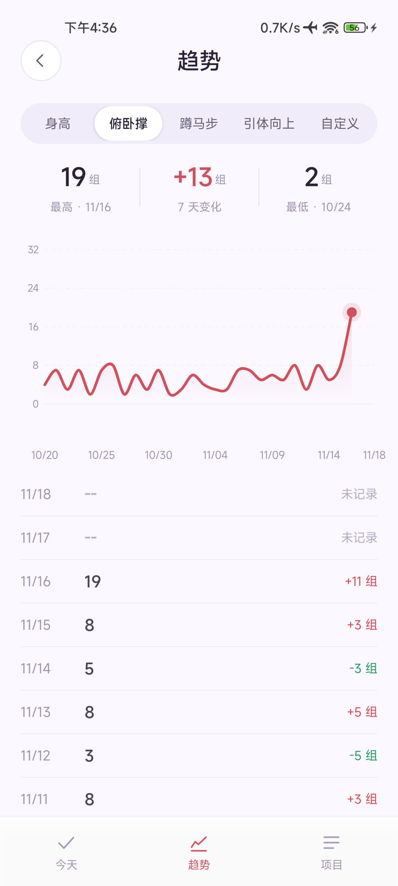
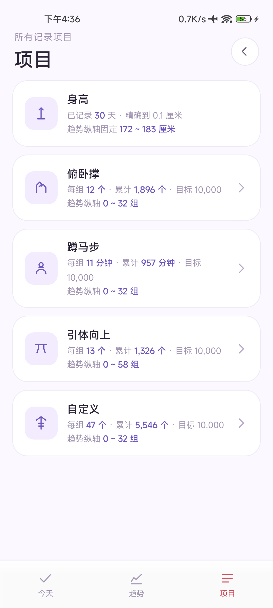

# 日刻 · daytally

> A minimal daily-tally app for Android. Tap once to add a set, watch the week fill up, and see the trend at a glance — from your home screen.

极简的每日自我量化工具。每天记一个数，桌面随时看，按格往上攒。

- **中文名** 日刻
- **英文名** daytally
- **包名** `com.beike.daytally`

名字里的 tally 就是"一道道刻痕计数"——tally stick（记数刻痕木棍）是人类最早的计数工具，上面刻的正是"刻度"。所以它同时装下了「刻度」和「计数」两层。

---

## 它解决什么问题

想记录每天做了多少，但不想要一个塞满课程、社区、勋章、打卡地图的健身 App。

日刻只做三件事：

1. 今天做了多少（点一下加一组，直接累加）
2. 这周是什么走势（7 天 / 30 天折线）
3. 离目标还有多远（累计 vs 目标）

其余的都在桌面完成——不用打开 App，点一下桌面那块小方格就加了一组。

## 功能

**今天页**：按项目列出今天累计值，右侧大按钮加一组；顶部是本周 7 天条带（红涨绿落）；身高一类的小数项目单列一张渐变卡。

**趋势页**：项目切换 + 三栏统计（最高 / 变化 / 最低）+ 折线图（面积渐变、末点高亮）+ 逐日明细。

**项目页**：每个项目的每组数量、累计、目标、纵轴范围，点卡片可改设置。

**桌面小部件**：4 个 1×1 方块（俯卧撑 / 蹲马步 / 引体向上 / 自定义），一个 4×2 大卡（7 天矩阵 + 项目切换）。方块点一下加一组，环朝总目标走。

## 截图

| 今天 | 趋势 | 项目 |
| --- | --- | --- |
|  |  |  |

## 技术栈

- Kotlin，原生 Android View + Canvas，**没有引入任何第三方 UI 框架**
- 依赖只有 androidx 基础库（core-ktx / appcompat / material / constraintlayout / recyclerview）
- 数据落本地 JSON（应用私有目录），不上传、不联网
- minSdk 26 / targetSdk 34

UI 是按一份 HTML 原型 1:1 复刻的。原型屏幕逻辑宽 350px，真机逻辑宽 411dp，所以全局用 `Ui.S = 1.175` 做等比换算——尺寸、字号、间距一起放大，比例才不走样。这段逻辑在 `DailyScale/app/src/main/java/com/beike/daytally/util/Ui.kt`。

## 项目结构

```
身高计数组件App/
├── DailyScale/                        Android 工程（Gradle）
│   ├── app/src/main/java/com/beike/daytally/
│   │   ├── MainActivity.kt            三页容器 + 底栏
│   │   ├── Repo.kt                    本地 JSON 读写 + 种子数据
│   │   ├── model/Metric.kt            项目数据模型
│   │   ├── ui/HomeView.kt             今天页
│   │   ├── ui/TrendView.kt            趋势页
│   │   ├── ui/ChartView.kt            折线图（Canvas，按 320×200 viewBox 等比）
│   │   ├── ui/ProjectsView.kt         项目页
│   │   ├── util/Ui.kt                 等比换算 dp / sp / wdp
│   │   └── widget/                    5 个桌面组件
│   └── app/src/main/res/              布局、drawable、主题
├── 每日刻度APP原型版本1.html           设计基准（当前 v9）
├── 每日刻度APP原型版本1修改备份/       v1～v8 迭代留档
├── 每日刻度APP原型版本2修改备份/       下一轮改版用
├── docs/screenshots/
└── 小刻度-App落地方案与提示词.md        早期落地方案
```

> `DailyScale` 是工程的早期目录名，一直没改；实际包名与项目名是 `com.beike.daytally` / daytally。

## 构建

需要 JDK 17 与 Android SDK 34。

```bash
cd DailyScale
./gradlew assembleRelease      # Windows: gradlew.bat assembleRelease
```

产物在 `app/build/outputs/apk/release/app-release.apk`。

## 关于签名

**这个仓库不含任何签名私钥。** 想在本地打 release 包，在 `DailyScale/` 下自建 `keystore.properties`（已列入 .gitignore）：

```properties
storeFile=app/keystore/your.jks
storePassword=...
keyAlias=...
keyPassword=...
```

没有这个文件时，`release` 会自动退回 debug 签名，所以 clone 下来照样能构建、能装。

## 原型与版本

`每日刻度APP原型版本1.html` 是这套 UI 的唯一设计基准，直接浏览器打开就能看，所有尺寸、配色、文案以它为准。它前面的 8 份迭代备份（v1～v8）在 `每日刻度APP原型版本1修改备份/` 里，当前定稿是 v9。

下一轮大改会另起 `每日刻度APP原型版本2.html`，备份进 `每日刻度APP原型版本2修改备份/`。

## 更新日志

见 [CHANGELOG.md](CHANGELOG.md)。

## License

MIT
