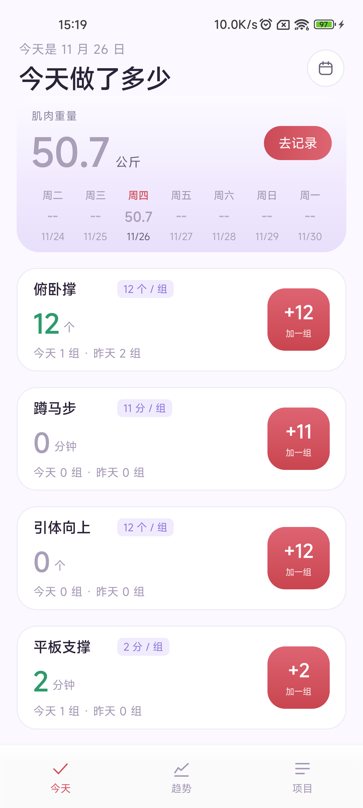

# 日刻 · daytally

> A minimal daily-tally app for Android. Tap once to add a set, watch the week fill up, and see the trend at a glance — from your home screen.

极简的每日自我量化工具。每天记一个数，桌面随时看，按格往上攒。

- **中文名** 日刻
- **英文名** daytally
- **包名** `com.beike.daytally`

名字里的 tally 就是"一道道刻痕计数"——tally stick（记数刻痕木棍）是人类最早的计数工具，上面刻的正是"刻度"。所以它同时装下了「刻度」和「计数」两层。

## 当前版本

**1.2.5**（2026-11-20）——桌面方块「点上排却加下排」的坐标错位已修；今日页按住底栏「项目」1 秒进设置（日期行跟着变红），项目页仍 5 秒；设置页补回「关掉后桌面方块恢复原生长按，可拖动、可移除」说明；身高记录范围改为 0～227 厘米。完整记录见 [CHANGELOG.md](CHANGELOG.md)。

---

## 它解决什么问题

想记录每天做了多少，但不想要一个塞满课程、社区、勋章、打卡地图的健身 App。

日刻只做三件事：

1. 今天做了多少（点一下加一组，直接累加）
2. 这周是什么走势（7 天 / 30 天折线）
3. 离目标还有多远（累计 vs 目标）

其余的都在桌面完成——不用打开 App，点一下桌面那块小方格就加了一组。

## 功能

**今天页**：按项目列出今天累计值，右侧大按钮加一组；顶部是本周 7 天条带（红涨绿落）；身高一类的小数项目单列一张渐变卡。

**趋势页**：项目切换 + 三栏统计（最高 / 变化 / 最低）+ 折线图（面积渐变、末点高亮）+ 逐日明细。

**项目页**：每个项目的每组数量、累计、目标、纵轴范围，点卡片可改设置。

**桌面小部件**：4 个 1×1 方块（俯卧撑 / 蹲马步 / 引体向上 / 自定义），一个 4×2 大卡（7 天矩阵 + 项目切换）。方块点一下加一组，环朝总目标走。

## 截图

| 今天 | 趋势 | 项目 |
| --- | --- | --- |
|  |  |  |

**桌面小部件**：4 个 1×1 方块（俯卧撑 / 蹲马步 / 引体向上 / 自定义）+ 2 张 4×2 大卡（身高卡、计数卡）。方块点一下加一组（弹出 `+12` 飘字），长按 **0.15 秒**减一组（弹出 `−12`）；大卡有 7 天条带，条带固定 **周二 → 周一**。

## 桌面长按接管与 Vector 模块

App 自己就是 Xposed 模块，**长按减组靠它**——不需要再装第二个 APK。

### 启用

1. Vector（或 LSPosed）→ 打开「日刻」总开关
2. 点进「日刻」→ 作用域勾选两个：
   - `com.beike.daytally`
   - **`com.miui.home`（系统桌面，不是米家）**
3. 重启桌面生效：`adb shell am force-stop com.miui.home`，再按一下 Home

### 为什么长按必须靠模块

MIUI 桌面的触摸**根本不进组件自己的 View**，全被 `com.miui.home.launcher.widget.DragContainerLayout` 这一层收走，长按菜单也是它弹的。所以只有在桌面进程里挂钩子，才能做出「长按方块 = 减一组」，并把震动、缩放入场、浮动数字一起画在桌面层。

没有模块时：方块单击加组照常（走原生 PendingIntent），但**长按不能减组**，也没有 0.93 缩放和 `+12` 飘字。

### 关掉模块后长按怎么恢复

**这是 LSPosed 的机制限制，不是 bug**：关模块只是让下次启动不再注入，**已经注入进桌面进程的钩子还活着**，所以长按依旧被接管。

三种恢复方式，按推荐顺序：

| 方式 | 操作 | 生效 |
|---|---|---|
| **App 内开关（推荐）** | 日刻 → **项目页长按「项目」二字 5 秒**（底栏「项目」Tab 长按 5 秒也行）→ 进隐藏设置页 → 关掉「桌面长按接管」；在**今日页**按住底栏「项目」1 秒就能进 | **立刻**，不用重启任何东西 |
| 重启桌面 | `adb shell am force-stop com.miui.home` 后按 Home | 立刻 |
| 关模块 + 重启桌面 | 两件都要做 | 立刻 |

App 里那个开关是往桌面进程发一条广播，钩子收到就自动置为「不接管」，所以是拿回原生长按最快的方式。

> Vector 本身没有软重启命令。查过 `/data/adb/lspd/cli` 的全部子命令（`status` / `modules` / `scope` / `config` / `db` / `log`），也 grep 过 `/data/adb/lspd` 与 `/data/adb/modules/zygisk_vector`，都没有 soft-reboot 相关入口。所以「关模块后立刻恢复」只能靠 App 内这个开关，不需要重启手机。

> 模块开启期间，桌面上长按方块会**被钩子整条吃掉**，MIUI 原生的「移除 / 编辑」菜单不会弹。要整理桌面，先关上面那个开关。

### 误触修复：怎么区分「点方块」和「点方块上面的东西」

旧版钩子挂在全局 `View.dispatchTouchEvent`，**只要坐标落在方块矩形内就吃掉事件**。结果很糟：文件夹展开后点里面的图标、从多任务切到别的 App，都会被当成点了方块，组数白涨。

现在改成三层判定，**只有真的点在方块上才接管**：

1. **遮挡判定**——从 `DecorView` 往下找 `Folder`、或类名含 `Recents`/`MultiTask`/`TaskView` 的可见全屏 View，命中就直接放行；再用反射 `WindowManagerGlobal.mViews` 兜住所有窗口根视图。
2. **命中判定**——四个 1×1 方块的 `LauncherAppWidgetHostView` **不在 `DecorView` 子树里**（MIUI 把它们挂在 `DragContainerLayout` 的登记表上），所以坐标从 `hostViews` 登记表取。`getLocationOnScreen` 对这些 view 返回的 y 带一个固定容器偏移，实测真实中心是 `cy = loc[1] − height/2`、`cx = loc[0] + width/2`，再取**最近邻 + 210px 阈值**。
3. **兜底**——三处 widget 层 hook（`OnLongClickAgent` / `LauncherAppWidgetHostView` / `LauncherWidgetView`）作为备用，不参与主路径。

真机双向验证：第 6 页点方块 → 组数 +1；第 6 页打开文件夹 → 点「小鱼弹琴」→ 应用正常打开、四个方块数据一个不动；第 1 页（方块已离屏）点文件夹图标 → 不误触。

### 已知限制：多任务界面里点方块会误加组

MIUI 13 的最近任务是 `RecentsAnimation`，**不产生新的 Activity**，桌面一直停在 `Launcher`，窗口焦点也还在。所以钩子没法分辨「用户是在桌面上点方块」还是「在多任务缩略图里点了同一块区域」——在任务切换界面按到方块的位置，仍会加一组。

试过四种判断都不成立（扫 Recents 类名、扫 `RecentsActivity` 可见性、反射 `ActivityThread` 的活动栈、判 `hasWindowFocus`），最激进的那版会让桌面正常状态下的所有点击被吃掉（长按直接弹 MIUI「移除」菜单），比误触更糟，已回退。**这条按取舍保留，不算 bug**：宁可多任务里偶尔误加，也不牺牲桌面上正常的点按与长按。

## 技术栈

- Kotlin，原生 Android View + Canvas，**没有引入任何第三方 UI 框架**
- 依赖只有 androidx 基础库（core-ktx / appcompat / material / constraintlayout / recyclerview）
- 数据落本地 JSON（应用私有目录），不上传、不联网
- minSdk 26 / targetSdk 34

UI 是按一份 HTML 原型 1:1 复刻的。原型屏幕逻辑宽 350px，真机逻辑宽 411dp，所以全局用 `Ui.S = 1.175` 做等比换算——尺寸、字号、间距一起放大，比例才不走样。这段逻辑在 `DailyScale/app/src/main/java/com/beike/daytally/util/Ui.kt`。

## 项目结构

```
身高计数组件App/
├── DailyScale/                        Android 工程（Gradle）
│   ├── app/src/main/java/com/beike/daytally/
│   │   ├── MainActivity.kt            三页容器 + 底栏
│   │   ├── Repo.kt                    本地 JSON 读写 + 种子数据
│   │   ├── model/Metric.kt            项目数据模型
│   │   ├── ui/HomeView.kt             今天页
│   │   ├── ui/TrendView.kt            趋势页
│   │   ├── ui/ChartView.kt            折线图（Canvas，按 320×200 viewBox 等比）
│   │   ├── ui/ProjectsView.kt         项目页
│   │   ├── util/Ui.kt                 等比换算 dp / sp / wdp
│   │   └── widget/                    5 个桌面组件
│   └── app/src/main/res/              布局、drawable、主题
├── 每日刻度APP原型版本1.html           设计基准（当前 v11）
├── 每日刻度APP原型版本1修改备份/       v1～v10 迭代留档
├── 每日刻度APP原型版本2修改备份/       下一轮改版用
├── docs/screenshots/
└── 小刻度-App落地方案与提示词.md        早期落地方案
```

> `DailyScale` 是工程的早期目录名，一直没改；实际包名与项目名是 `com.beike.daytally` / daytally。

## 构建

需要 JDK 17 与 Android SDK 34。

```bash
cd DailyScale
./gradlew assembleRelease      # Windows: gradlew.bat assembleRelease
```

产物在 `app/build/outputs/apk/release/app-release.apk`。

## 关于签名

**这个仓库不含任何签名私钥。** 想在本地打 release 包，在 `DailyScale/` 下自建 `keystore.properties`（已列入 .gitignore）：

```properties
storeFile=app/keystore/your.jks
storePassword=...
keyAlias=...
keyPassword=...
```

没有这个文件时，`release` 会自动退回 debug 签名，所以 clone 下来照样能构建、能装。

## 原型与版本

`每日刻度APP原型版本1.html` 是这套 UI 的唯一设计基准，直接浏览器打开就能看，所有尺寸、配色、文案以它为准。它前面的 10 份迭代备份在 `每日刻度APP原型版本1修改备份/` 里，统一命名 `小刻度-App原型-vN备份YYYYMMDD.html`（第一份没有版本号，叫 `小刻度-App原型-备份20261116.html`），当前定稿是 **v11**（新增隐藏设置页场景、今日页/项目页五段间隙等距、项目页副标题「所有日刻项目 · 长按项目进入设置」按住变红）。

> 备份只在备份目录留一份，工作目录根下不放同名副本；命名按版本号连续，别用「第 N 版」这种会跟「原型一 / 原型二」混淆的叫法。

下一轮大改会另起 `每日刻度APP原型版本2.html`，备份进 `每日刻度APP原型版本2修改备份/`。

## 更新日志

见 [CHANGELOG.md](CHANGELOG.md)。

## License

MIT
