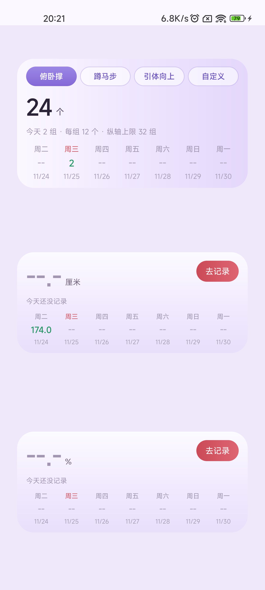

# 日刻第二阶段交付报告

日期：2026-11-25  
范围：体脂率三端打通 + OKOK 两类残留广告清理

## 这次到底做了什么

一句话：以前日刻只认“身高、五个计数项目”，现在把**体脂率**当成独立的一项正式数据，手机桌面、手机同步、树莓派和 Windows 电脑都能看见；同时把 OKOK 里用户截图指出的两个广告位清掉。

没有重做 DayTally，原来的身高大卡、计数组件、五个项目都没有改。体脂率单独存、单独同步，不塞进身高字段，也不混进任何计数项目。

## 交付物

| 交付物 | 位置 | 说明 |
|---|---|---|
| 日刻 Android 安装包 | `DailyScale/dist/日刻-1.3.0.apk` | 版本 1.3.0 / versionCode 16，已覆盖安装到当前小米 11，原数据保留 |
| OKOKDeclutter 模块包 | `OKOKDeclutter/dist/OKOKDeclutter-1.1.0.apk` | 版本 1.1.0 / versionCode 2，已覆盖安装，Vector 作用域仍是 OKOK |
| Windows 数据中台 | `C:\windows软件编译\daytally-dashboard\dist\日刻数据中台.exe` | 版本 1.1.0，已重新打包，带体脂率页面 |
| 服务端代码 | `身高计数组件App/server/app.py` | 1.3.0，已部署到树莓派 `192.168.0.27:8787` |

SHA-256：

- `日刻-1.3.0.apk`：`D9DDE83B9475262937DDD763E1C5AE905A737D18D977C1EF90349D4B0188650C`
- `OKOKDeclutter-1.1.0.apk`：`0F0BC5D496F9397644B6DF7D800943B5D58F5FB85AAAD9ABDFA9760CBB0898F9`
- `日刻数据中台.exe`：`14B788E39801A77BA8E79C51D34F33475134B6BE0D76376D0BC01178F575D247`

## 用户怎么用

### 体脂率大卡

1. 在手机桌面长按空白处，添加“日刻”的“体脂率 · 大卡”。
2. 卡片版式和原来的身高大卡一样，只把单位换成 `%`；没记录时显示 `--.-` 和“今天还没记录”。
3. 点卡片右上“去记录”，会打开官方 OKOK；测完按返回键回日刻，日刻弹出确认单，核对/填写后保存。
4. 保存后，桌面大卡显示最新体脂率、测量时间和来源；手机同步开启时，树莓派和 Windows 电脑也能看到。

### OKOK 广告

- 测量页“请光脚站上秤”下方原来的第三方广告位：已隐藏。
- 首页服务端下发的居中活动弹窗：已拦截，不再弹出。
- 原有 1.0.0 的开屏、首页活动横幅、打卡浮层、AI 浮窗、报告页底部广告和状态动画提示，规则全部保留。
- 没有拦网络、没有改账号、没有改 OKOK 的健康数据。

## 验证结果

### 树莓派服务端

- `python -m unittest discover`：7 条测试全部通过，0 failure / 0 error。
- 线上 `/health` 返回 `1.3.0`、`bodyFatSupported:true`。
- 部署后数据库：`events=283`、`configs=5`、`body_fat_records=0`；旧数据未清。
- 体脂表、索引、清空接口均已存在；本次没有向真实库里写测试记录，避免污染真实数据。

### 手机 App

- release 构建成功，JVM 单测 10 条通过（`BodyFatPolicyJavaTest` 5 条、`BodyFatMergeJavaTest` 5 条）。
- 已覆盖安装到小米 11；使用 `adb install -r`，没有卸载、没有清应用数据，原有身高和计数数据仍能在预览页看到。
- 用隐藏的组件预览页拍到了真实 RemoteViews：身高大卡和体脂率大卡上下对照，尺寸、圆角、字体、颜色、按钮位置、7 天条带均一致；体脂卡单位是 `%`，空态是“今天还没记录”。

- 体脂率数据层独立文件 `body_fat_records.json`，不写 `Repo.metrics`，不加入 `Repo.order`；合并去重规则有单测。
- `去记录` 的正常路径和手动确认兜底都保留；失败时不会静默写假数据。

### OKOKDeclutter

- 目标机已安装的 OKOK 版本已核对：3.7.63 / versionCode 255。
- 在目标 APK 中只读确认：`HomePopDilog`、`PopDialogUtils`、`BluetoothUpScaleActivity`、`popup_center_layout`、`activity_bluetooth_up_scale` 均存在；测量页 `containerLayout` id 为 `0x7f090631`。
- release 构建成功，7 条单测通过，Lint 0 error。
- 覆盖安装 1.1.0 后，日志显示 `active for OKOK 3.7.63 (255)`。
- 测量页倒计时 26 秒时截图，底部广告位为空，倒计时和测量内容正常。
- 用运行时构造 `HomePopDilog(activity).show()` 定向验证，模块日志出现 `suppressed home operation popup`，界面没有弹窗。
- 首页截图确认原有四处广告仍不显示，正常首页内容完整。

### Windows 数据中台

- `node --check web/app.js` 通过。
- PyInstaller 重新打包成功，EXE 版本 1.1.0。
- 用 `--serve-only` 启动新 EXE 做冒烟测试：`/api/health` 返回 1.1.0，首页含“体脂率”入口，HTTP 200。
- 体脂页此前用 6 条真实形态 mock 数据做过截图校验：当前 22.3%、6 条记录、历史最高/最低、区间变化、趋势 6 个点、历史表 6 行，布局沿用了原 PC 风格。
- 体脂页只读树莓派记录，不在电脑上新增体脂；清空弹窗会说明体脂记录也会被清掉。

## 还没完成 / 需要知道的边界

1. **OKOK 自动读体脂还没打通**
   现在点“去记录”会打开 OKOK，测完回日刻后由用户确认数值再保存；还没有 OKOK 官方数据接口或稳定的自动读取 Hook。也就是说，不会在后台悄悄读 OKOK 数据，也不会自动造假。

2. **真实体脂记录还没做端到端落库测试**
   服务端单测和客户端单测都过了，但当前树莓派 `body_fat_records=0`，没有用真实手机 + 真实服务端写入一条体脂记录再同步到 Windows。原因是不能为了测试污染用户真实数据。正式使用第一条记录时，建议按“去记录 → 确认 → 同步 → Windows 查看”走一遍。

3. **Windows 端只读**
   按目前需求，PC 只显示树莓派里的体脂记录，不提供 PC 手动新增入口；也没有生成模拟历史。

4. **GitHub / Linear 未同步**
   本轮没有执行“commit 并同步 linear”，没有提交 GitHub、没有新建 Linear issue，也没有打新 Release 标签。

5. **完整全场景回归**
   1.1.0 已专门验证新增的两类广告和首页正常内容；1.0.0 的旧回归仍有效，但 1.1.0 尚未做“账号、报告、测量、设置”全天完整回归。

## 关键文件

- 服务端：`身高计数组件App/server/app.py`、`server/tests/test_app.py`、`server/README.md`
- Android 数据层：`DailyScale/app/src/main/java/com/beike/daytally/bodyfat/`
- 体脂组件：`DailyScale/app/src/main/java/com/beike/daytally/widget/BodyFatWidget.kt`
- 体脂布局：`DailyScale/app/src/main/res/layout/widget_body_fat.xml`
- Android 单测：`DailyScale/app/src/test/java/com/beike/daytally/bodyfat/`
- Windows：`daytally-dashboard/web/index.html`、`web/app.js`、`web/style.css`、`app.py`
- OKOK 模块：`OKOKDeclutter/app/src/main/java/io/github/seashell666/okokdeclutter/ModuleEntry.kt`、`OkokRules.kt`
- OKOK 验证记录：`OKOKDeclutter/docs/VALIDATION.md`

## 一句话交付

体脂率已经独立进入日刻的数据体系，手机桌面有和身高卡同版式的 4×2 大卡，树莓派能存能同步，Windows 能看历史/趋势/统计；OKOK 测量页底部广告和首页活动弹窗已在真机 3.7.63 上确认消失。剩下的是“自动读取 OKOK 体脂”和一轮真实数据的端到端验收，不是这次广告清理的阻塞项。
